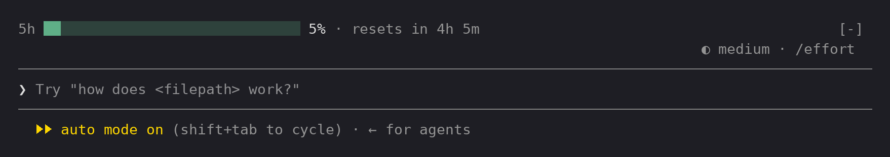
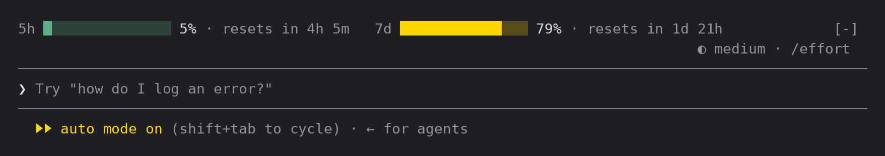

# claude-usage-bar

A Claude Code plugin that shows your 5-hour (and optionally weekly) usage limit as a bar graph just above the prompt, so you always know how much headroom you have left and when it resets.



With the weekly limit turned on, both windows share the same line:



## What it shows

- **5h** – the rolling 5-hour usage window
- **7d** – the 7-day usage window (optional, off by default)
- How much of each window you've used, as a bar and a percentage
- A countdown to when each window resets

The bar changes colour as you use more:

| Usage    | Colour |
| -------- | ------ |
| < 70%    | green  |
| 70–89%   | yellow |
| 90%+     | red    |

The bar updates whenever Claude Code reports new rate-limit data. It stays hidden until there's usage data to show.

## Install

```sh
claude plugin marketplace add thatskiff33/claude-usage-bar
claude plugin install usage-bar@claude-usage-bar
```

Or from inside Claude Code:

```
/plugin marketplace add thatskiff33/claude-usage-bar
/plugin install usage-bar@claude-usage-bar
```

Restart Claude Code (or run `/reload-plugins`) and the bar appears above the prompt.

## Options

| Option              | Default | Description                                     |
| ------------------- | ------- | ----------------------------------------------- |
| Show weekly usage   | off     | Also show the 7-day usage limit on the same line |

To change it, run `/plugin configure usage-bar@claude-usage-bar` inside Claude Code, then restart.

## Updating

```sh
claude plugin marketplace update claude-usage-bar
claude plugin update usage-bar@claude-usage-bar
```

## Uninstall

```sh
claude plugin uninstall usage-bar@claude-usage-bar
```
